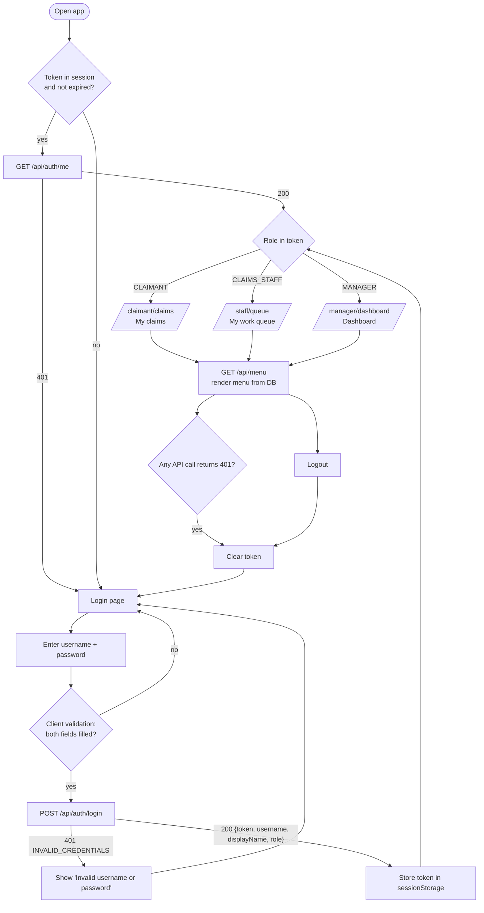
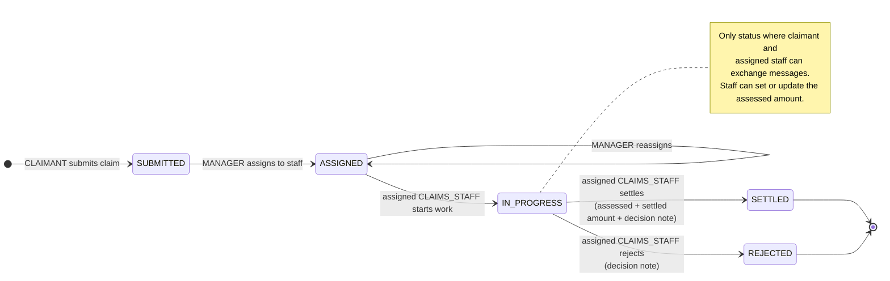
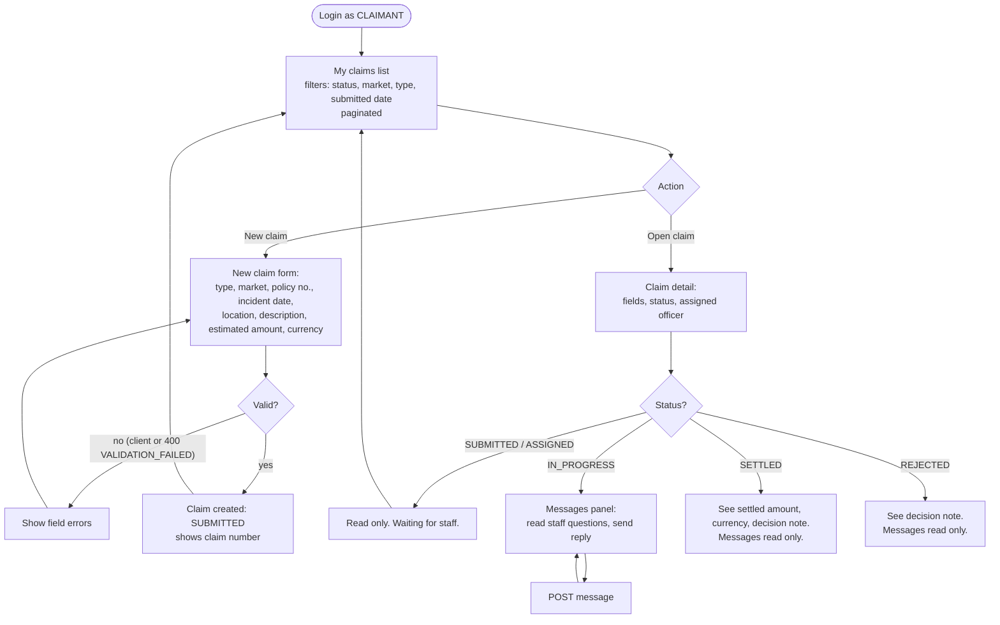
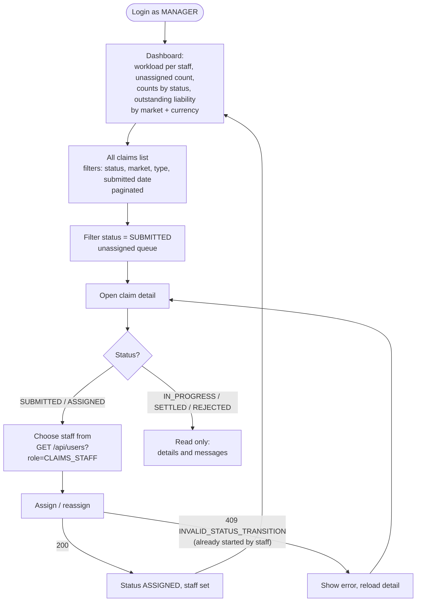
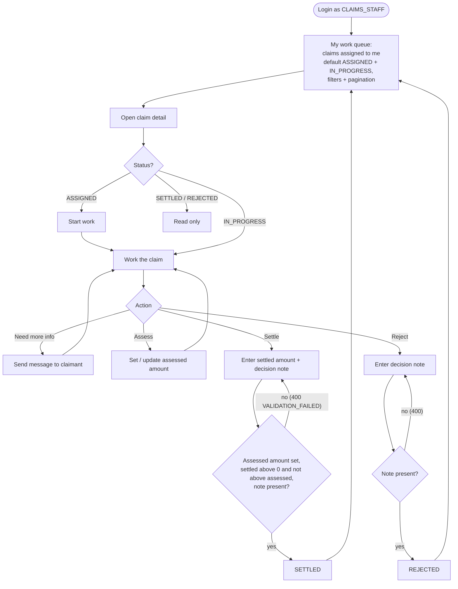
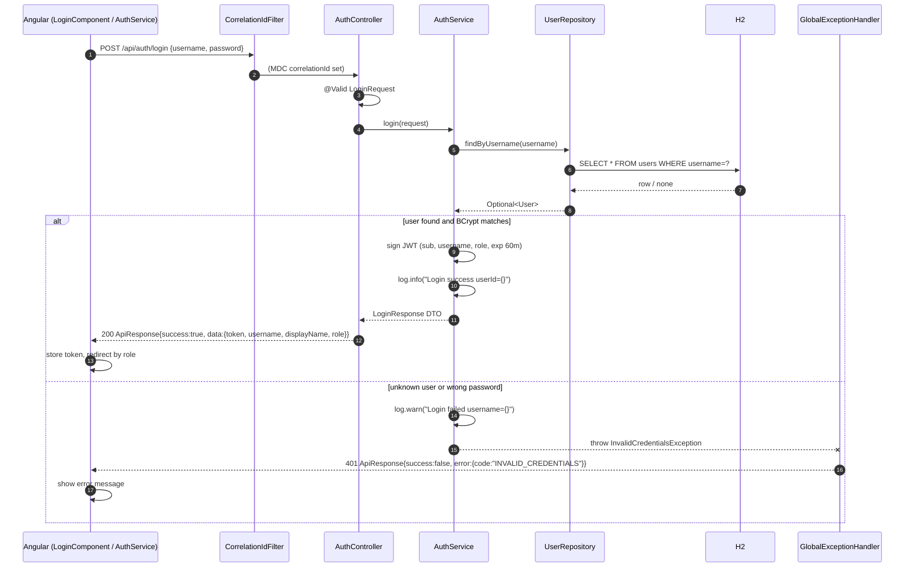
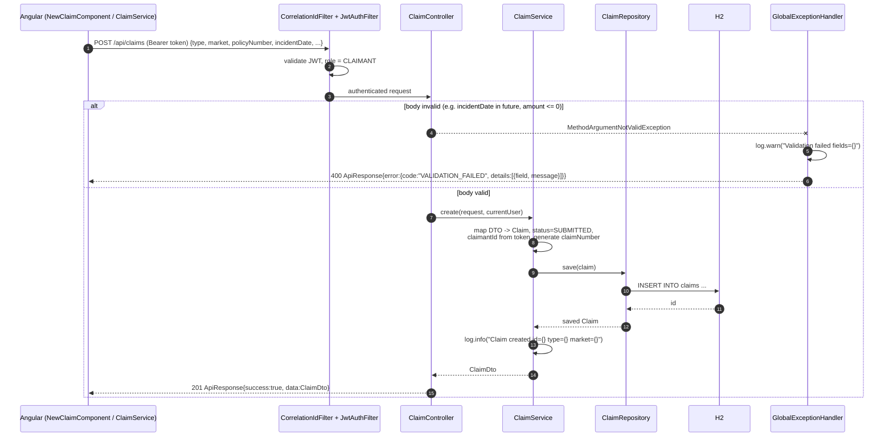
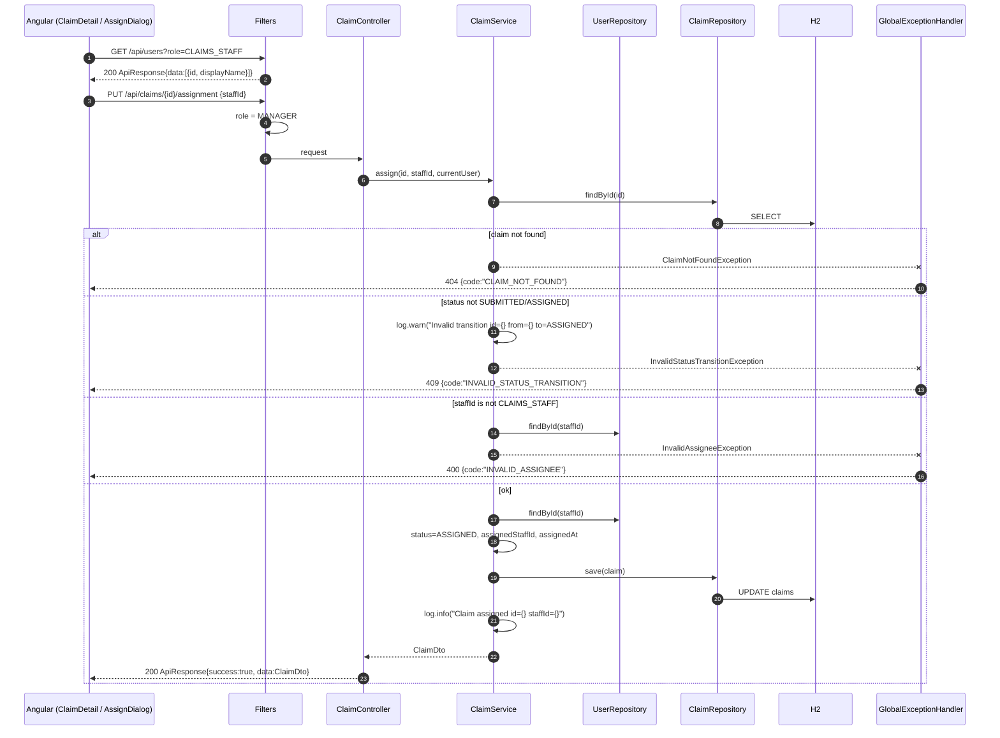
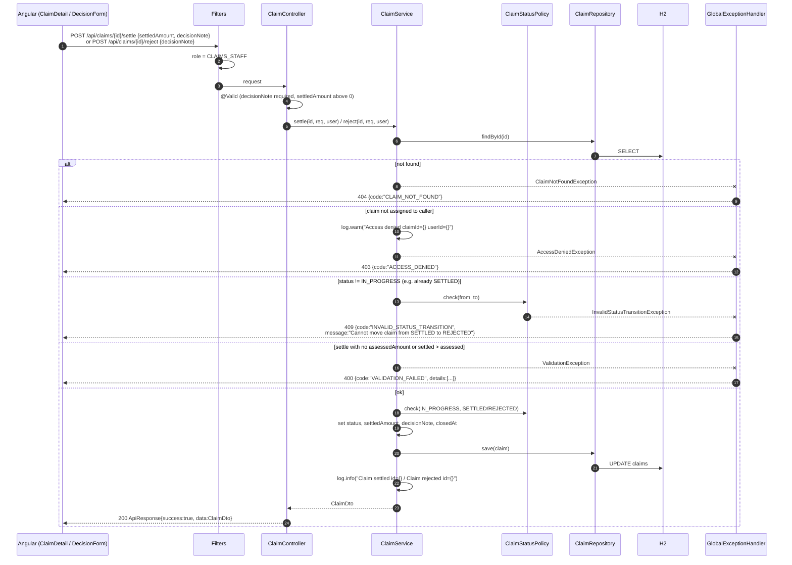
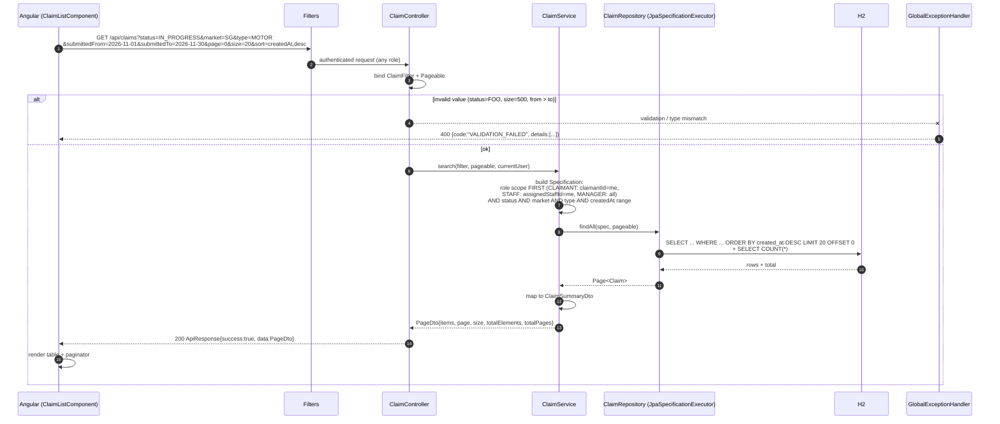

# 02 — Workflow

**Project:** chubb-claims
**Status:** Approved by Kowsar (2026-11-25). Revised the same day with Kowsar's OK: the menu is now loaded from the database through `GET /api/menu`.
**Date:** 2026-11-25
**Based on:** `01-requirements.md` (approved), `CLAUDE.md`, `00-candidate_assessment_brief.docx`

Roles are **CLAIMANT**, **CLAIMS_STAFF** and **MANAGER**, as in the approved requirements.

> Endpoint paths in this document are **provisional**. `04-api-spec.yaml` (step 5) is the source of truth and may rename them.

| Provisional endpoint | Purpose |
|---|---|
| `POST /api/auth/login` | Log in and get a JWT |
| `GET /api/auth/me` | Current user, used to restore the session |
| `GET /api/claims` | Role-scoped claim list with filters and pagination |
| `POST /api/claims` | Claimant submits a claim |
| `GET /api/claims/{id}` | Claim detail |
| `PUT /api/claims/{id}/assignment` | Manager assigns or reassigns |
| `POST /api/claims/{id}/start` | Staff starts work |
| `PATCH /api/claims/{id}/assessment` | Staff sets the assessed amount |
| `POST /api/claims/{id}/settle` | Staff settles |
| `POST /api/claims/{id}/reject` | Staff rejects |
| `GET`, `POST /api/claims/{id}/messages` | Read and send messages |
| `GET /api/users?role=CLAIMS_STAFF` | Staff list for assignment |
| `GET /api/dashboard` | Manager workload and liability |
| `GET /api/menu` | Menu for the caller's role, from `roles`, `menus` and `role_menu` |

---

## 1. Login flow

**Notes**
- The server checks the username against the `users` table and the password against its BCrypt hash. On success it signs a JWT (HS256, 60 minutes) holding the user id, username and role.
- An unknown user and a wrong password give the same 401 `INVALID_CREDENTIALS`, so usernames can't be guessed. A WARN is logged with the username but never the password.
- The client stores the token, and an HTTP interceptor adds `Authorization: Bearer <token>` to every call.
- The client then calls `GET /api/menu`. The server reads the menu for the user's role from `role_menu` and `menus` in display order. The first item is the home route, which matches the redirect in the diagram (seed data in 03 §3.5).
- Role route guards stop a user from opening another role's URL. Such a request is redirected to the user's own home page. The API enforces the same rules (403 `ACCESS_DENIED`), so the guards are only for user experience.
- Logout is client side only: the token is thrown away. A 401 from any call does the same and goes back to the login page.

---

## 2. Claim lifecycle

| From | To | Who | Preconditions | Timestamps set |
|---|---|---|---|---|
| (none) | SUBMITTED | CLAIMANT | Valid claim fields | `createdAt` |
| SUBMITTED | ASSIGNED | MANAGER | Target user has the CLAIMS_STAFF role | `assignedAt` |
| ASSIGNED | ASSIGNED | MANAGER | Target user has the CLAIMS_STAFF role (reassign) | `assignedAt` (reset) |
| ASSIGNED | IN_PROGRESS | CLAIMS_STAFF | Caller is the assigned staff member | `startedAt` |
| IN_PROGRESS | SETTLED | CLAIMS_STAFF | Caller is the assigned staff member. `assessedAmount` is already set. `settledAmount` is > 0 and ≤ `assessedAmount`. `decisionNote` is required. | `closedAt` |
| IN_PROGRESS | REJECTED | CLAIMS_STAFF | Caller is the assigned staff member. `decisionNote` is required. | `closedAt` |

**Notes**
- All transitions go through one place in the service layer, the claim status policy, which holds this table. Any move not in the table returns **409 `INVALID_STATUS_TRANSITION`**.
- Checks run in a fixed order, so errors are predictable: 401 (not logged in) → 403 (wrong role, or not the assigned staff) → 404 (claim not found, or not the claimant's own) → 409 (wrong status) → 400 (bad body). Body validation of the request DTO happens before the service is called, so a malformed body returns 400 first.
- SETTLED and REJECTED are final. No further transitions, messages or assessment changes are allowed.
- Each transition is logged at INFO with the claim id, the from and to statuses and the actor id. If FR-20 is built, it is also written to `claim_status_history` in the same transaction.

---

## 3. Main user flows

### 3.1 CLAIMANT

**Notes:** The claimant sees only their own claims, because the server scopes the list by `claimantId` from the token. Opening another claimant's claim returns 404. They can message only while the claim is IN_PROGRESS, and the decision note shows after the claim closes.

### 3.2 MANAGER

**Notes:** The manager has a read-only view of every claim and its messages. Their only state-changing action is assign or reassign, and only while a claim is SUBMITTED or ASSIGNED. The dashboard is recalculated from the database on every load, so it is always current. The 409 path covers a staff member starting the claim while the manager has the page open.

### 3.3 CLAIMS_STAFF

**Notes:** Staff work only claims assigned to them. Any action on someone else's claim returns 403 `ACCESS_DENIED`. They can't pick up unassigned claims, because the manager assigns them (confirmed A2). Messages and assessment changes are allowed only while IN_PROGRESS. The decision note is required on both settle and reject, and the claimant sees it.

---

## 4. API call sequences

Every request goes through the same chain:

| Order | Component | Job |
|---|---|---|
| 1 | `CorrelationIdFilter` | Reads `X-Correlation-Id` or generates one, puts it in MDC, adds it to the response, and clears it at the end |
| 2 | `JwtAuthFilter` (Spring Security) | Checks the token and sets the user id and role. A missing or invalid token returns 401. |
| 3 | Controller | Takes a DTO, runs `@Valid`, calls the service, and wraps the result in `ApiResponse<T>` |
| 4 | Service | Business rules, role and ownership checks, status policy, mapping between entities and DTOs, and logging |
| 5 | Repository | Spring Data JPA |
| 6 | H2 | File mode database |
| (error) | `GlobalExceptionHandler` (`@RestControllerAdvice`) | Turns any exception into a failure envelope with the right HTTP status |

Security filter errors (401 and 403 before the controller) are written in the same envelope by the security entry point and access-denied handlers.

### 4.1 Login (including a bad password)

**Note:** The password and token are never logged. An unknown user and a wrong password follow the same path and return the same error.

### 4.2 Submit claim (including a validation error)

**Note:** The claimant id always comes from the token and never from the request body. A wrong role, such as a manager calling this endpoint, is stopped at the security layer with 403 `ACCESS_DENIED`.

### 4.3 Manager assigns a claim

**Note:** Reassigning uses the same call while the claim is ASSIGNED. Optimistic locking (`@Version`) on the claim turns a race, such as staff starting the claim at the same moment, into a 409 instead of a lost update.

### 4.4 Staff settles or rejects (including the 409 error)

**Note:** The decision note and amounts are never logged, only ids and statuses. Any unexpected exception becomes a 500 `INTERNAL_ERROR` with a generic message. The full stack trace goes to the ERROR log with the correlation id.

### 4.5 Filtered and paginated claim list

**Note:** Role scoping is always added on the server first, so a claimant can't widen the scope with query parameters. `submittedFrom` and `submittedTo` are inclusive dates compared with `createdAt` in UTC. The upper bound is the end of that day.

---

## 5. Role and permission rules

✓ = allowed, — = not allowed (403 unless the Notes column says otherwise).

| # | Action | Endpoint (provisional) | CLAIMANT | CLAIMS_STAFF | MANAGER | Notes |
|---|---|---|:-:|:-:|:-:|---|
| P1 | Log in | `POST /api/auth/login` | ✓ | ✓ | ✓ | Public endpoint |
| P2 | Get current user | `GET /api/auth/me` | ✓ | ✓ | ✓ | |
| P3 | Submit claim | `POST /api/claims` | ✓ | — | — | Claimant id comes from the token |
| P4 | List claims (filters + pagination) | `GET /api/claims` | ✓ own | ✓ assigned to me | ✓ all | The server applies role scope before filters |
| P5 | View claim detail | `GET /api/claims/{id}` | ✓ own | ✓ assigned to me | ✓ all | Claimant on another's claim gets **404**. Staff on a claim not assigned to them gets 403. |
| P6 | List staff users | `GET /api/users?role=CLAIMS_STAFF` | — | — | ✓ | For the assign dialog |
| P7 | Assign or reassign | `PUT /api/claims/{id}/assignment` | — | — | ✓ | Only from SUBMITTED or ASSIGNED, otherwise 409. Non-staff target gives 400 `INVALID_ASSIGNEE`. |
| P8 | Start work | `POST /api/claims/{id}/start` | — | ✓ assigned to me | — | Only from ASSIGNED, otherwise 409 |
| P9 | Set assessed amount | `PATCH /api/claims/{id}/assessment` | — | ✓ assigned to me | — | Only IN_PROGRESS, otherwise 409. Amount must be ≥ 0. |
| P10 | Read messages | `GET /api/claims/{id}/messages` | ✓ own | ✓ assigned to me | ✓ all | Any status, read only after close |
| P11 | Send message | `POST /api/claims/{id}/messages` | ✓ own | ✓ assigned to me | — | Only IN_PROGRESS, otherwise 409 `MESSAGING_NOT_ALLOWED` |
| P12 | Settle | `POST /api/claims/{id}/settle` | — | ✓ assigned to me | — | IN_PROGRESS only. Needs the assessed amount, 0 < settled ≤ assessed, and a decision note. |
| P13 | Reject | `POST /api/claims/{id}/reject` | — | ✓ assigned to me | — | IN_PROGRESS only. Needs a decision note. |
| P14 | View dashboard | `GET /api/dashboard` | — | — | ✓ | Workload, counts by status, unassigned count, liability by market and currency |
| P15 | Any endpoint without a valid token | any except P1 and Swagger | 401 | 401 | 401 | `UNAUTHORIZED`, and the client goes back to login |
| P16 | Get my menu | `GET /api/menu` | ✓ | ✓ | ✓ | Returns only the caller's role menu, from the DB |

**Notes**
- The **role** check happens in Spring Security config or with `@PreAuthorize`. **Ownership** checks (own or assigned) and **status** checks happen in the service layer, because they need the claim from the database.
- MANAGER is deliberately not allowed to settle or reject. Keeping assignment and decision separate is a simple control that is easy to explain in the walkthrough.

---

## 6. Confirmed refinements

These don't change the approved requirements. They make them more precise. Kowsar confirmed all four on 2026-11-25.

| # | Point | Decision |
|---|---|---|
| W1 | Staff opening a claim that isn't assigned to them | 403 `ACCESS_DENIED`. The 404 rule applies to claimants only (A4). |
| W2 | Settle uses the stored `assessedAmount`, which is set beforehand through P9, so the settle body is `{settledAmount, decisionNote}` | Yes |
| W3 | New error code `UNAUTHORIZED` for a missing or invalid token. `INVALID_CREDENTIALS` stays login only. | Yes |
| W4 | Optimistic locking (`@Version`) on claims, so concurrent changes give 409 | Yes |
