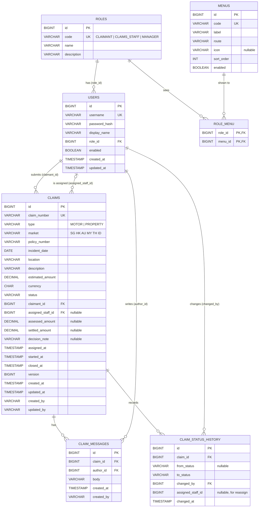
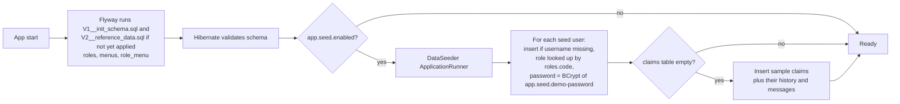

# 03 — DB design

**Project:** chubb-claims
**Status:** Approved by Kowsar (2026-11-25)
**Date:** 2026-11-25
**Based on:** `01-requirements.md` and `02-workflow.md` (both approved), and `CLAUDE.md`

## 0. Decisions

| Decision | Choice |
|---|---|
| Database | H2 in file mode (`jdbc:h2:file:./data/db`). Data survives restarts. |
| Schema management | **Flyway** migrations (`db/migration/V1__init_schema.sql`). Hibernate runs with `ddl-auto=validate`, so it only checks the schema and never changes it. |
| Seed data | A Java startup seeder (`ApplicationRunner`) hashes passwords with BCrypt and inserts what is missing. It is safe to run on every start. |
| Roles | **`roles` table** (Kowsar's decision, replacing the earlier enum column). Each user links to one role through `users.role_id`, matching the one-role-per-user rule. |
| Menus | **Which role sees which menu is defined in the database** in `menus` and the link table `role_menu` (§3.5). The API serves the caller's menu, and Angular renders it. Roles, menus and role_menu are reference data loaded by Flyway (`V2__reference_data.sql`). |
| Deletes | **No deletes and no soft delete.** No endpoint or service deletes rows. Closed claims stay as permanent records, and users can only be disabled through `enabled`. |
| Ids | `BIGINT` identity primary keys. The business key for claims is `claim_number`. |
| Money | `DECIMAL(15,2)` mapped to `BigDecimal`. Each amount has a currency. There is no conversion. |
| Time | Timestamps are `TIMESTAMP WITH TIME ZONE` mapped to `Instant`, stored in UTC. `incident_date` is `DATE` mapped to `LocalDate`. |
| Enums in the database | `VARCHAR` with a `CHECK` constraint, mapped with `@Enumerated(EnumType.STRING)`. Never ordinal. |

---

## 1. ERD

**Notes**
- `claims` has two foreign keys to `users`: the claimant who owns it and the staff member it is assigned to.
- Messages and status history are child tables of `claims`. They are only ever added to, never updated or deleted.
- `roles` is the single source of roles. `users.role_id` links each user to one role, and `role_menu` is the many-to-many link between `roles` and `menus`.
- A user's menu is found by following `users.role_id`, then `role_menu`, then `menus`.
- Notifications (FR-22, a nice-to-have) are **not** modelled now. They would become a `notifications` table in a later migration (`V3__notifications.sql`).

---

## 2. Enums

| Enum | Values | Used in | Source |
|---|---|---|---|
| `ClaimStatus` | `SUBMITTED`, `ASSIGNED`, `IN_PROGRESS`, `SETTLED`, `REJECTED` | `claims.status`, `claim_status_history.from_status` / `to_status` | 01 §5.2, 02 §2 |
| `ClaimType` | `MOTOR`, `PROPERTY` | `claims.type` | 01 §5.1 |
| `Market` | `SG`, `HK`, `AU`, `MY`, `TH`, `ID` | `claims.market` | 01 A1 |
| `Currency` | `SGD`, `HKD`, `AUD`, `MYR`, `THB`, `IDR` | `claims.currency` | 01 §5.1, the six market currencies |

**Roles are not an enum in the database.** They are rows in `roles` (§3.0). Java keeps the role codes as constants (`RoleCode.CLAIMANT`, `CLAIMS_STAFF`, `MANAGER`) for `@PreAuthorize` and the service checks. These constants must match `roles.code`, and a startup check fails fast if a code is missing.

Helper sets, defined in Java code and not stored:
- `ClaimStatus.OPEN` = {SUBMITTED, ASSIGNED, IN_PROGRESS}, used for liability and workload.
- `ClaimStatus.CLOSED` = {SETTLED, REJECTED}.
- `Market.defaultCurrency()` gives SG→SGD, HK→HKD, AU→AUD, MY→MYR, TH→THB, ID→IDR.

---

## 3. Table definitions

### 3.0 `roles`

| Column | Type | Nullable | Constraints | Notes |
|---|---|:-:|---|---|
| `id` | BIGINT | N | PK, identity | |
| `code` | VARCHAR(20) | N | UNIQUE (`uk_roles_code`) | `CLAIMANT`, `CLAIMS_STAFF`, `MANAGER`. Used in the JWT `role` claim and in Spring Security authorities (`ROLE_<code>`). |
| `name` | VARCHAR(50) | N | | Display name, e.g. "Claims staff" |
| `description` | VARCHAR(200) | Y | | |

**Seed (`V2__reference_data.sql`)**

| code | name |
|---|---|
| `CLAIMANT` | Claimant |
| `CLAIMS_STAFF` | Claims staff |
| `MANAGER` | Manager |

### 3.1 `users`

| Column | Type | Nullable | Constraints | Notes |
|---|---|:-:|---|---|
| `id` | BIGINT | N | PK, identity | |
| `username` | VARCHAR(50) | N | UNIQUE (`uk_users_username`) | Login name, stored in lower case |
| `password_hash` | VARCHAR(100) | N | | BCrypt hash (60 characters). Never returned in a DTO and never logged. |
| `display_name` | VARCHAR(100) | N | | Shown in the UI, e.g. "Chris Lim" |
| `role_id` | BIGINT | N | FK → `roles.id` (`fk_users_role`) | One role per user |
| `enabled` | BOOLEAN | N | DEFAULT TRUE | Login is refused when false. This is the only way to "remove" a user. |
| `created_at` | TIMESTAMP WITH TIME ZONE | N | | Auditing |
| `updated_at` | TIMESTAMP WITH TIME ZONE | N | | Auditing |

`users` has no `created_by`, because all users come from the seeder. There is no user-management API.

### 3.2 `claims`

| Column | Type | Nullable | Constraints | Notes |
|---|---|:-:|---|---|
| `id` | BIGINT | N | PK, identity | |
| `claim_number` | VARCHAR(20) | N | UNIQUE (`uk_claims_claim_number`) | `CLM-YYYY-NNNNNN`, from sequence `claim_number_seq` (see §6) |
| `type` | VARCHAR(10) | N | CHECK in `ClaimType` | |
| `market` | VARCHAR(2) | N | CHECK in `Market` | |
| `policy_number` | VARCHAR(30) | N | | Free text (01 A10) |
| `incident_date` | DATE | N | | "Not in the future" is checked in the service, because it depends on the current date |
| `location` | VARCHAR(200) | N | | |
| `description` | VARCHAR(2000) | N | | 10 to 2000 characters, checked on the DTO |
| `estimated_amount` | DECIMAL(15,2) | N | CHECK > 0 | |
| `currency` | VARCHAR(3) | N | CHECK in `Currency` | Defaults to the market's currency |
| `status` | VARCHAR(15) | N | CHECK in `ClaimStatus` | Changed only through the status policy (02 §2) |
| `claimant_id` | BIGINT | N | FK → `users.id` (`fk_claims_claimant`) | Taken from the JWT |
| `assigned_staff_id` | BIGINT | Y | FK → `users.id` (`fk_claims_staff`) | Null while SUBMITTED |
| `assessed_amount` | DECIMAL(15,2) | Y | CHECK ≥ 0 | Set by staff while IN_PROGRESS |
| `settled_amount` | DECIMAL(15,2) | Y | CHECK > 0, CHECK ≤ `assessed_amount` | Set only on SETTLED |
| `decision_note` | VARCHAR(2000) | Y | | Required on SETTLED and REJECTED |
| `assigned_at` | TIMESTAMP WITH TIME ZONE | Y | | Set again on reassign |
| `started_at` | TIMESTAMP WITH TIME ZONE | Y | | ASSIGNED → IN_PROGRESS |
| `closed_at` | TIMESTAMP WITH TIME ZONE | Y | | SETTLED or REJECTED |
| `version` | BIGINT | N | DEFAULT 0 | `@Version` optimistic lock (02 W4). A clash returns 409. |
| `created_at` | TIMESTAMP WITH TIME ZONE | N | | The submitted date, used by the `submittedFrom` / `submittedTo` filter (01 A12) |
| `updated_at` | TIMESTAMP WITH TIME ZONE | N | | |
| `created_by` | VARCHAR(50) | N | | Username of the creator, or `system` for seed data |
| `updated_by` | VARCHAR(50) | N | | Username of the last modifier |

**Table-level CHECK constraints.** These are a second line of defence. The service checks the same rules first and returns the right error codes.

| Name | Rule |
|---|---|
| `ck_claims_assignee_required` | `status = 'SUBMITTED' OR assigned_staff_id IS NOT NULL` |
| `ck_claims_settled_fields` | `status <> 'SETTLED' OR (assessed_amount IS NOT NULL AND settled_amount IS NOT NULL AND decision_note IS NOT NULL AND closed_at IS NOT NULL)` |
| `ck_claims_rejected_fields` | `status <> 'REJECTED' OR (decision_note IS NOT NULL AND closed_at IS NOT NULL)` |
| `ck_claims_settled_le_assessed` | `settled_amount IS NULL OR settled_amount <= assessed_amount` |

### 3.3 `claim_messages`

| Column | Type | Nullable | Constraints | Notes |
|---|---|:-:|---|---|
| `id` | BIGINT | N | PK, identity | |
| `claim_id` | BIGINT | N | FK → `claims.id` (`fk_messages_claim`) | |
| `author_id` | BIGINT | N | FK → `users.id` (`fk_messages_author`) | The claimant or the assigned staff member (02 P11) |
| `body` | VARCHAR(2000) | N | | 1 to 2000 characters. Never logged. |
| `created_at` | TIMESTAMP WITH TIME ZONE | N | | Messages are sorted by this |
| `created_by` | VARCHAR(50) | N | | Username |

The author's role label comes from `author_id` → `users.role_id` → `roles`. The earlier `author_role` text column was removed so the role lives only in `roles`.

Messages are only added. They have no `updated_at` and can't be edited or deleted. Whether the claim is IN_PROGRESS is checked in the service (409 `MESSAGING_NOT_ALLOWED`).

### 3.4 `claim_status_history`

This table supports FR-20 (should-have), the timeline in FR-21 and the settle-time metrics in FR-24.

| Column | Type | Nullable | Constraints | Notes |
|---|---|:-:|---|---|
| `id` | BIGINT | N | PK, identity | |
| `claim_id` | BIGINT | N | FK → `claims.id` (`fk_history_claim`) | |
| `from_status` | VARCHAR(15) | Y | CHECK in `ClaimStatus` | Null for the first SUBMITTED row |
| `to_status` | VARCHAR(15) | N | CHECK in `ClaimStatus` | |
| `changed_by` | BIGINT | N | FK → `users.id` (`fk_history_user`) | The user who made the change |
| `assigned_staff_id` | BIGINT | Y | | The staff member assigned at that moment, so a reassign (ASSIGNED → ASSIGNED) is visible |
| `changed_at` | TIMESTAMP WITH TIME ZONE | N | | |

Rows are written in the **same transaction** as the claim update. They are only added, and the history table has no audit columns of its own beyond `changed_by` and `changed_at`.

### 3.5 `menus` and `role_menu` (role → menu)

These tables hold **which menus each role sees**. This is reference data: Flyway inserts it, and the app never changes it at runtime.

**`menus`**

| Column | Type | Nullable | Constraints | Notes |
|---|---|:-:|---|---|
| `id` | BIGINT | N | PK, identity | |
| `code` | VARCHAR(30) | N | UNIQUE (`uk_menus_code`) | Stable key, e.g. `MY_CLAIMS` |
| `label` | VARCHAR(50) | N | | Text shown in the menu |
| `route` | VARCHAR(100) | N | | Angular route, e.g. `/claimant/claims` |
| `icon` | VARCHAR(30) | Y | | Optional icon name |
| `sort_order` | INT | N | | Order within the menu |
| `enabled` | BOOLEAN | N | DEFAULT TRUE | Hides an item without deleting it |

**`role_menu`**

| Column | Type | Nullable | Constraints | Notes |
|---|---|:-:|---|---|
| `role_id` | BIGINT | N | PK (with `menu_id`), FK → `roles.id` (`fk_role_menu_role`) | |
| `menu_id` | BIGINT | N | PK (with `role_id`), FK → `menus.id` (`fk_role_menu_menu`) | |

**Seed (`V2__reference_data.sql`).** This matches the menu in 01 §3.2. The ✓ marks are the `role_menu` rows.

| code | label | route | sort | CLAIMANT | CLAIMS_STAFF | MANAGER |
|---|---|---|:-:|:-:|:-:|:-:|
| `MY_CLAIMS` | My claims | `/claimant/claims` | 10 | ✓ | | |
| `NEW_CLAIM` | New claim | `/claimant/claims/new` | 20 | ✓ | | |
| `MY_QUEUE` | My work queue | `/staff/queue` | 10 | | ✓ | |
| `DASHBOARD` | Dashboard | `/manager/dashboard` | 10 | | | ✓ |
| `ALL_CLAIMS` | All claims | `/manager/claims` | 20 | | | ✓ |

**Notes**
- **Not in the table:** claim detail is opened from a list, so it isn't a menu item. Logout is a fixed client action shown to every logged-in user, so it isn't stored either.
- **Home page:** the item with the lowest `sort_order` is the role's home page after login, for example `DASHBOARD` for MANAGER.
- **Menus don't control access.** The database menu decides what is **shown**. Endpoint access is still enforced by Spring Security and the service checks (02 §5). Angular route guards also check the role, so hiding a menu item never replaces a permission check.
- **Proposed endpoint:** `GET /api/menu` returns the caller's enabled items in `sort_order`. Angular loads it after login and on refresh, and builds the sidebar from it. Details go into `04-api-spec.yaml`.

---

## 4. Relationships, indexes and unique constraints

### 4.1 Foreign keys

| FK | From | To | On delete | Cardinality |
|---|---|---|---|---|
| `fk_claims_claimant` | `claims.claimant_id` | `users.id` | RESTRICT | Each user has 0..n claims as claimant, and each claim has exactly 1 claimant |
| `fk_claims_staff` | `claims.assigned_staff_id` | `users.id` | RESTRICT | Each staff member has 0..n assigned claims, and each claim has 0..1 assigned staff member |
| `fk_messages_claim` | `claim_messages.claim_id` | `claims.id` | RESTRICT | Each claim has 0..n messages |
| `fk_messages_author` | `claim_messages.author_id` | `users.id` | RESTRICT | |
| `fk_history_claim` | `claim_status_history.claim_id` | `claims.id` | RESTRICT | Each claim has 1..n history rows |
| `fk_history_user` | `claim_status_history.changed_by` | `users.id` | RESTRICT | |
| `fk_users_role` | `users.role_id` | `roles.id` | RESTRICT | Each role has 0..n users, and each user has exactly 1 role |
| `fk_role_menu_role` | `role_menu.role_id` | `roles.id` | RESTRICT | Roles and menus are many-to-many through `role_menu` |
| `fk_role_menu_menu` | `role_menu.menu_id` | `menus.id` | RESTRICT | |

Every foreign key uses RESTRICT. This matches the no-deletes rule: the database itself refuses to delete anything that is referenced.

### 4.2 Unique constraints

| Name | Table | Columns |
|---|---|---|
| `uk_users_username` | users | `username` |
| `uk_claims_claim_number` | claims | `claim_number` |
| `uk_roles_code` | roles | `code` |
| `uk_menus_code` | menus | `code` |
| `pk_role_menu` | role_menu | `role_id, menu_id` (composite PK) |

### 4.3 Indexes

| Name | Table | Columns | Serves |
|---|---|---|---|
| `ix_users_role` | users | `role_id` | Staff list for assignment (P6) |
| `ix_claims_claimant_created` | claims | `claimant_id, created_at DESC` | Claimant "My claims" list (P4) |
| `ix_claims_staff_status` | claims | `assigned_staff_id, status` | Staff queue (P4) and dashboard workload per staff member |
| `ix_claims_status_created` | claims | `status, created_at DESC` | Manager list filtered by status, including the unassigned queue |
| `ix_claims_market_currency_status` | claims | `market, currency, status` | Liability by market and currency, and the market filter |
| `ix_claims_type` | claims | `type` | Type filter |
| `ix_messages_claim_created` | claim_messages | `claim_id, created_at` | Message thread in time order |
| `ix_history_claim_changed` | claim_status_history | `claim_id, changed_at` | Timeline |

The composite PK on `role_menu` starts with `role_id`, so it already serves the menu lookup by role.

Primary keys and unique constraints are indexed automatically. At demo volume H2 doesn't need more than this. The indexes are there to show that the access paths were thought through.

### 4.4 Queries that drive the design

| Use | Shape |
|---|---|
| Filtered list (02 §4.5) | JPA `Specification`: role scope AND `status` AND `market` AND `type` AND `created_at` between `submittedFrom` and `submittedTo`, using `Pageable`, ordered by `created_at DESC` by default |
| Workload (FR-18) | `SELECT assigned_staff_id, status, COUNT(*) FROM claims WHERE status IN ('ASSIGNED','IN_PROGRESS') GROUP BY assigned_staff_id, status` |
| Unassigned count | `COUNT(*) WHERE status = 'SUBMITTED'` |
| Counts by status | `SELECT status, COUNT(*) FROM claims GROUP BY status` |
| Outstanding liability (01 §5.3) | `SELECT market, currency, SUM(COALESCE(assessed_amount, estimated_amount)) FROM claims WHERE status IN ('SUBMITTED','ASSIGNED','IN_PROGRESS') GROUP BY market, currency` |
| Settled total | `SELECT currency, SUM(settled_amount) FROM claims WHERE status = 'SETTLED' GROUP BY currency` |
| Menu for a role | `SELECT m.* FROM menus m JOIN role_menu rm ON rm.menu_id = m.id WHERE rm.role_id = ? AND m.enabled = TRUE ORDER BY m.sort_order` |
| Staff list (P6) | `SELECT u.* FROM users u JOIN roles r ON r.id = u.role_id WHERE r.code = 'CLAIMS_STAFF' AND u.enabled = TRUE` |

The dashboard queries are JPQL `@Query` methods that return interface projections (for example `LiabilityRow`), so no entities are loaded.

---

## 5. Audit columns and soft-delete rule

| Column | How it is filled |
|---|---|
| `created_at`, `updated_at` | Spring Data JPA auditing (`@EnableJpaAuditing`, `@CreatedDate`, `@LastModifiedDate`), using a UTC `Instant` |
| `created_by`, `updated_by` | `@CreatedBy` / `@LastModifiedBy` through an `AuditorAware<String>` bean that returns the username from the `SecurityContext`, or `system` when there is no authenticated user (the seeder) |
| `claim_status_history` | Written explicitly by the service on every transition. This is the business audit trail. |

Common columns sit in a `@MappedSuperclass` `AuditableEntity`, used by `Claim` and `User`. `User` has no `created_by` or `updated_by`, so it extends a smaller `TimestampedEntity`.

**Soft delete:** none. No table has a `deleted` flag, because nothing is deleted (§0). Users are deactivated with `enabled = false`.

---

## 6. JPA entity notes

| Entity | Table | Key mapping notes |
|---|---|---|
| `Role` | `roles` | Read only (`@Immutable`). It is cached, because there are only 3 rows. |
| `User` | `users` | `@ManyToOne(fetch = LAZY, optional = false) role`. Login loads the user with its role in one query (`@EntityGraph("role")` / `JOIN FETCH`). `passwordHash` is never exposed in a DTO and `toString` leaves it out. Also used as the principal source for Spring Security (`UserDetailsService`). |
| `Claim` | `claims` | `@ManyToOne(fetch = LAZY, optional = false) claimant`. `@ManyToOne(fetch = LAZY) assignedStaff`. `@Version Long version`. Enums use `STRING`. Amounts use `BigDecimal` with `@Column(precision = 15, scale = 2)`. |
| `ClaimMessage` | `claim_messages` | `@ManyToOne(fetch = LAZY) claim` and `@ManyToOne(fetch = LAZY) author`. Immutable: no setters after creation and `@Column(updatable = false)`. |
| `ClaimStatusHistory` | `claim_status_history` | `@ManyToOne(fetch = LAZY) claim` and `@ManyToOne(fetch = LAZY) changedBy`. Immutable. |
| `Menu` | `menus` | Read only (`@Immutable`). |
| `Role` ↔ `Menu` | `role_menu` | `@ManyToMany(fetch = LAZY)` on `Role.menus` with `@JoinTable(name = "role_menu", joinColumns = role_id, inverseJoinColumns = menu_id)`. Read only, no cascade. `MenuRepository` has a JPQL query by role id that returns the menu as a DTO projection, ordered by `sort_order`. |

| Topic | Rule | Reason |
|---|---|---|
| Fetch type | **LAZY on every `@ManyToOne`** (the JPA default is EAGER, so it is set explicitly) | Avoids loading users with every claim |
| Collections | **No `@OneToMany` collections** on `Claim`. The only collection anywhere is the read-only `Role.menus`. Messages and history are loaded through their own repositories (`findByClaimIdOrderByCreatedAtAsc`). | Keeps `Claim` small, avoids accidental N+1 and cascade surprises, and fits append-only children |
| Cascade | **None.** Each entity is saved through its own repository inside one `@Transactional` service method. | Nothing is ever deleted, and explicit saves are easier to follow |
| N+1 on lists | List queries use `@EntityGraph(attributePaths = {"claimant", "assignedStaff"})` or a DTO projection, so the display names come in one query | Paged list with names |
| Open session in view | `spring.jpa.open-in-view=false` | Lazy loading only happens inside the service, and mapping to DTOs happens there (CLAUDE.md layering) |
| Claim number | DB sequence `claim_number_seq`, read through a small `ClaimNumberGenerator` (`SELECT NEXT VALUE FOR claim_number_seq`), formatted as `CLM-<year>-<6-digit seq>` | Unique, readable and works across restarts |
| Time zone | `spring.jpa.properties.hibernate.jdbc.time_zone=UTC` | Consistent UTC storage |
| Equality | `equals` and `hashCode` use `id`, with a null-safe pattern, and no Lombok `@Data` on entities | Avoids lazy-loading traps and broken hash sets |

---

## 7. Seed data plan

### 7.1 How it loads

| Rule | Detail |
|---|---|
| Reference data | Roles, menus and role_menu are loaded by Flyway in `V2__reference_data.sql`, because they are fixed data with no secrets. Flyway runs each migration only once, so this is idempotent by design. A later change to roles or menus means a new migration. |
| Users | Created by the Java seeder, because the passwords must be BCrypt-hashed. Each user's role is looked up with `roles.code`. |
| Idempotent | Users are matched by `username`. Sample claims are inserted only when `claims` is empty. Restarting with H2 file mode never creates duplicates. |
| Passwords | Hashed at startup with Spring Security's `BCryptPasswordEncoder` (strength 10). The plain password comes from `app.seed.demo-password`, which has a default in `application.yml` and can be overridden by an environment variable. It is documented in the README and never logged. |
| Transaction | The seeder runs in one `@Transactional` method, so a partial seed is rolled back. |
| Logging | INFO "Seeded users count={} claims={}", or "Seed skipped, data present". No names and no passwords. |
| Tests | Tests use `jdbc:h2:mem:` with the same Flyway migration. The seeder is on by default, and tests that need an empty database set `app.seed.enabled=false`. |
| Reset | Stop the app and delete `./data/`. The next start recreates everything. |

### 7.2 Seed users

All five users share one demo password.

| username | display_name | role |
|---|---|---|
| `claimant1` | Alice Tan | CLAIMANT |
| `claimant2` | Ben Wong | CLAIMANT |
| `staff1` | Chris Lim | CLAIMS_STAFF |
| `staff2` | Dana Ng | CLAIMS_STAFF |
| `manager1` | Evan Lee | MANAGER |

### 7.3 Sample claims

There are eight claims, enough that each list, filter and dashboard figure has data.

| # | Claimant | Type | Market | Currency | Estimated | Status | Assigned | Assessed | Settled | Note |
|---|---|---|---|---|---:|---|---|---:|---:|---|
| 1 | claimant1 | MOTOR | SG | SGD | 4,500.00 | SUBMITTED | | | | Unassigned |
| 2 | claimant2 | PROPERTY | HK | HKD | 80,000.00 | SUBMITTED | | | | Unassigned |
| 3 | claimant1 | PROPERTY | AU | AUD | 12,000.00 | ASSIGNED | staff1 | | | |
| 4 | claimant2 | MOTOR | MY | MYR | 6,200.00 | IN_PROGRESS | staff1 | 5,800.00 | | Has 2 messages |
| 5 | claimant1 | MOTOR | SG | SGD | 3,000.00 | IN_PROGRESS | staff2 | | | Liability uses the estimate |
| 6 | claimant2 | PROPERTY | TH | THB | 150,000.00 | SETTLED | staff2 | 140,000.00 | 135,000.00 | Decision note |
| 7 | claimant1 | MOTOR | ID | IDR | 25,000,000.00 | REJECTED | staff1 | | | Decision note |
| 8 | claimant2 | MOTOR | SG | SGD | 2,000.00 | SETTLED | staff1 | 2,000.00 | 1,800.00 | Decision note |

- `created_at` values are spread over the last 30 days, so the submitted-date filter has something to show.
- Each claim gets the history rows that match its path. For example, #6 has SUBMITTED, then ASSIGNED, then IN_PROGRESS, then SETTLED, with increasing timestamps.
- Seed text such as descriptions, locations and messages is clearly fictional demo content.

Expected dashboard figures from this seed, which can double as test checks:

| Figure | Value |
|---|---|
| Unassigned | 2 |
| Workload | staff1: 1 ASSIGNED, 1 IN_PROGRESS. staff2: 0 ASSIGNED, 1 IN_PROGRESS. |
| Outstanding liability | SG/SGD 7,500.00 (4,500 + 3,000), HK/HKD 80,000.00, AU/AUD 12,000.00, MY/MYR 5,800.00 (assessed) |

---

## 8. H2 file-mode configuration

| Property | Value | Note |
|---|---|---|
| `spring.datasource.url` | `jdbc:h2:file:./data/db` | Relative to the working directory. In Docker the working directory is `/app` and `/app/data` is a named volume. |
| `spring.datasource.username` / `password` | `sa` / from env `DB_PASSWORD` (empty by default locally) | |
| `spring.datasource.driver-class-name` | `org.h2.Driver` | |
| `spring.jpa.hibernate.ddl-auto` | `validate` | Flyway owns the schema |
| `spring.jpa.open-in-view` | `false` | |
| `spring.jpa.properties.hibernate.jdbc.time_zone` | `UTC` | |
| `spring.flyway.enabled` | `true` | Migrations in `classpath:db/migration` |
| `spring.h2.console.enabled` | `true` in the `dev` profile only, `false` by default and in the `docker` profile | |
| `spring.h2.console.path` | `/h2-console` | |
| `app.seed.enabled` | `true` | |
| `app.seed.demo-password` | default in yml, overridable with env `SEED_DEMO_PASSWORD` | |

`./data/` is already in `.gitignore`. In Docker the volume is mounted at `/app/data` so data survives `docker-compose down` and `up`.

### H2 console note

- The console is available at `http://localhost:8080/h2-console` **only in the `dev` profile**. Connect with JDBC URL `jdbc:h2:file:./data/db`, user `sa`.
- Spring Security permits `/h2-console/**` in `dev` only, and sets `frameOptions().sameOrigin()` and a CSRF ignore for that path, because the console uses frames and forms.
- In the `docker` profile the console is **off**, so the demo setup exposes no open database UI.
- H2 file mode allows **one process** at a time. Stop the app before opening the file with an external tool, or use the in-app console while the app runs.

---

## 9. Confirmed points

Kowsar confirmed all of these on 2026-11-25.

| # | Point | Decision |
|---|---|---|
| D1 | `currency` is limited to the six market currencies (SGD, HKD, AUD, MYR, THB, IDR) | Yes |
| D2 | `claim_status_history` is built as part of the core work (FR-20) | Yes |
| D3 | `created_by` and `updated_by` store the username as text, so the seeder can use `system` | Yes |
| D4 | The H2 console is enabled only in the `dev` profile | Yes |
| D5 | The role → menu mapping is held in the DB (`roles`, `menus`, `role_menu`, §3.5) and served by `GET /api/menu`. Access control stays in Spring Security. | Yes. `01-requirements.md` (§3.2, FR-06, FR-25, §8) and `02-workflow.md` (§1, P16) were updated to match. |
| D6 | Roles are a table (`roles`), linked through `users.role_id` with one role per user. Java keeps role-code constants that must match `roles.code`. | Yes |
