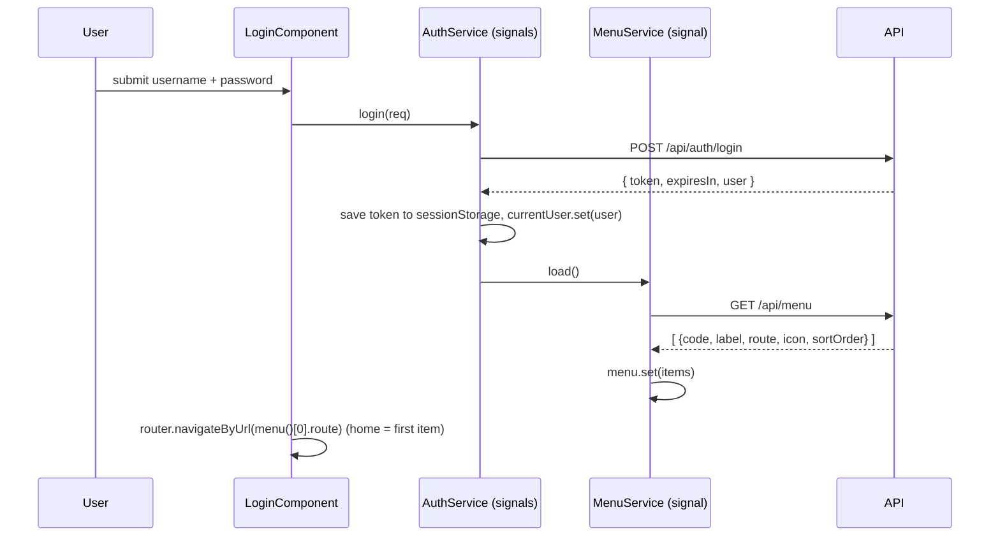
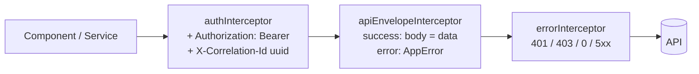

# 05 — Frontend spec (Angular 17)

**Project:** chubb-claims
**Status:** Approved by Kowsar (2026-11-25)
**Date:** 2026-11-25
**Based on:** `01-requirements.md`, `02-workflow.md`, `03-db-design.md`, `04-api-spec.yaml` (all approved), and `CLAUDE.md`

Roles are **CLAIMANT**, **CLAIMS_STAFF** and **MANAGER**, as in the approved docs. The step 6 message listed CLAIMANT and CLAIMANT_STAFF, but the approved docs have three roles.

## 0. Key decisions

| Topic | Choice | Reason |
|---|---|---|
| Framework | Angular 17, **standalone components** only, with the new control flow (`@if`, `@for`) | As in CLAUDE.md |
| State | **Signals** for app state (current user, menu, list filters, loading flags). RxJS only for HTTP. | Simple, built in, no store library needed at this size |
| Routing | `provideRouter` with **lazy-loaded feature routes** per role (`/claimant`, `/staff`, `/manager`) and functional guards | One app, two user groups (brief), and each role's code loads only when needed |
| HTTP | `provideHttpClient(withInterceptors([...]))` with functional interceptors | Angular 17 style |
| Charts | **ng2-charts 6 + Chart.js 4** (`ng2-charts@6.0.1`, `chart.js@4.4.x`). The dashboard has one **pie** chart and one **bar** chart (Kowsar's request). | ng2-charts gives a standalone `BaseChartDirective` and `provideCharts(withDefaultRegisterables())`. Chart.js is small, tree-shakable, canvas-based, and widely used with Angular 17. |
| UI library | **Angular Material 17** (table, paginator, form fields, select, datepicker, dialog, snackbar, sidenav, chips) | Official, works well with standalone components, accessible, and has the data table and paginator we need. Light enough when only the used modules are imported. |
| Styling | One Material theme plus plain SCSS with a few CSS variables. No Tailwind and no Bootstrap. | Keep it light |
| Menu | Loaded from **`GET /api/menu`** after login (FR-25). It is not hard-coded. | Approved in 01 §3.2 and 03 §3.5 |
| Access | **Route guards use the role in the JWT.** The API remains the real access control. | 01 §3.2 |

---

## 1. Screen list

| # | Screen | Route | Role | Purpose | API calls | Requirement |
|---|---|---|---|---|---|---|
| 1 | Login | `/login` | Public | Username and password login | `POST /api/auth/login`, then `GET /api/menu` | FR-02, US-01 |
| 2 | App shell (top bar, side menu) | wraps all routes below | All | Shows the menu from the DB, the user name and Logout | `GET /api/auth/me` (on refresh), `GET /api/menu` | FR-05, FR-06, FR-25, US-02 |
| 3 | My claims | `/claimant/claims` | CLAIMANT | Own claims with filters and paging | `GET /api/claims` | FR-08, FR-23, US-04 |
| 4 | New claim | `/claimant/claims/new` | CLAIMANT | Submit a claim | `POST /api/claims` | FR-07, US-03 |
| 5 | Claim detail (claimant) | `/claimant/claims/:id` | CLAIMANT | Status, details, messages (send while IN_PROGRESS) and decision | `GET /api/claims/{id}`, `GET`/`POST /api/claims/{id}/messages`, `GET /api/claims/{id}/history` | FR-08, FR-09, US-05, US-06 |
| 6 | My work queue | `/staff/queue` | CLAIMS_STAFF | Claims assigned to me. ASSIGNED and IN_PROGRESS by default. | `GET /api/claims?status=ASSIGNED&status=IN_PROGRESS` | FR-13, FR-23, US-10 |
| 7 | Claim detail (staff) | `/staff/claims/:id` | CLAIMS_STAFF | Start, assess, message, settle or reject | `GET /api/claims/{id}`, `POST …/start`, `PATCH …/assessment`, `POST …/settle`, `POST …/reject`, messages, history | FR-14 to FR-17, US-11 to US-14 |
| 8 | Dashboard | `/manager/dashboard` | MANAGER | Workload, counts and liability, with a period selector | `GET /api/dashboard?period=` | FR-18, US-09 |
| 9 | All claims | `/manager/claims` | MANAGER | Every claim with filters. `status=SUBMITTED` gives the unassigned queue. | `GET /api/claims` | FR-10, FR-23, US-07 |
| 10 | Claim detail (manager) | `/manager/claims/:id` | MANAGER | Read-only detail and messages, plus Assign or Reassign | `GET /api/claims/{id}`, messages (read), history, `GET /api/users?role=CLAIMS_STAFF`, `PUT …/assignment` | FR-11, FR-12, US-08 |
| 11 | Assign dialog | dialog on screen 10 | MANAGER | Pick a staff member | `GET /api/users?role=CLAIMS_STAFF`, `PUT /api/claims/{id}/assignment` | FR-11, FR-12 |
| 12 | Not found | `**` | All | Unknown route. Links back to the home page. | none | none |

The three claim detail routes use **one shared `ClaimDetailComponent`**. It shows a role-specific **action panel**: none for a claimant, the workflow actions for staff, and Assign for a manager.

---

## 2. Wireframes

### 2.1 Login

```
┌──────────────────────────────────────────┐
│              chubb-claims                │
│                                          │
│   Username  [______________________]     │
│   Password  [______________________]     │
│                                          │
│   ( Invalid username or password )  ← on 401
│                                          │
│              [   Log in   ]  ⟳ while busy│
└──────────────────────────────────────────┘
```

### 2.2 App shell

```
┌──────────────────────────────────────────────────────────────┐
│ ☰ chubb-claims                         Evan Lee (MANAGER) ⏻  │  ← top bar; ⏻ = Logout
├──────────────┬───────────────────────────────────────────────┤
│ Dashboard    │                                               │
│ All claims   │            <router-outlet>                    │
│              │                                               │
│ (from        │                                               │
│ GET /api/menu│                                               │
│  sortOrder)  │                                               │
└──────────────┴───────────────────────────────────────────────┘
```

### 2.3 Claim list (screens 3, 6 and 9 share `ClaimListComponent`)

```
┌──────────────────────────────────────────────────────────────────────────┐
│ My claims                                              [ + New claim ]   │ ← button only for CLAIMANT
├──────────────────────────────────────────────────────────────────────────┤
│ Status [All ▾]  Market [All ▾]  Type [All ▾]  Submitted [from] – [to]    │
│                                              [ Apply ] [ Clear ]         │
├────────────────┬────────┬────────┬────────────┬────────────┬─────────────┤
│ Claim no. ▲▼   │ Type   │ Market │ Incident   │ Estimated  │ Status      │
├────────────────┼────────┼────────┼────────────┼────────────┼─────────────┤
│ CLM-2026-000004│ MOTOR  │ MY     │ 2026-11-10 │ MYR 6,200  │ IN_PROGRESS │
│ …              │        │        │            │            │             │
├────────────────┴────────┴────────┴────────────┴────────────┴─────────────┤
│                                  Items per page [20 ▾]  1–20 of 57  ‹ ›  │
└──────────────────────────────────────────────────────────────────────────┘
 Manager and staff views add the columns "Claimant" and "Assigned to".
 Empty state:  "No claims match these filters."  [ Clear filters ]
```

### 2.4 New claim

```
┌──────────────────────────────────────────────────────┐
│ New claim                                            │
│ Type      (•) Motor  ( ) Property                    │
│ Market    [SG ▾]            Currency [SGD ▾] ← auto from market
│ Policy no.[____________]                             │
│ Incident date [📅 2026-11-20]                         │
│ Location  [__________________________________]       │
│ Description                                          │
│ [__________________________________________] 0/2000  │
│ Estimated amount [ 4,500.00 ]                        │
│                                                      │
│               [ Cancel ]   [ Submit claim ]          │
└──────────────────────────────────────────────────────┘
 On success: snackbar "Claim CLM-2026-000009 submitted", then go to its detail page.
```

### 2.5 Claim detail (shared, role-specific action panel)

```
┌──────────────────────────────────────────────────────────────────────────┐
│ ← Back   CLM-2026-000004            [ IN_PROGRESS ]                      │
├───────────────────────────────────────────┬──────────────────────────────┤
│ Details                                   │ Actions  (role-specific)     │
│ Type: MOTOR      Market: MY               │ STAFF + IN_PROGRESS:         │
│ Policy: POL-…    Incident: 2026-11-10     │  Assessed [ 5,800.00 ] [Save]│
│ Location: …                               │  ───────────────             │
│ Description: …                            │  [ Settle… ]  [ Reject… ]    │
│ Estimated: MYR 6,200.00                   │                              │
│ Assessed:  MYR 5,800.00                   │ STAFF + ASSIGNED:            │
│ Claimant: Ben Wong  Assigned: Chris Lim   │  [ Start work ]              │
├───────────────────────────────────────────┤                              │
│ Decision (when SETTLED / REJECTED)        │ MANAGER + SUBMITTED/ASSIGNED:│
│ Settled MYR 5,500.00 – "Approved …"       │  [ Assign… / Reassign… ]     │
├───────────────────────────────────────────┤                              │
│ Messages                                  │ CLAIMANT: (no actions)       │
│  Chris Lim (staff)  18 Nov 11:00          │                              │
│   Please send the workshop quote ref.     │                              │
│  Ben Wong (claimant) 18 Nov 17:12         │                              │
│   The quote reference is WS-88412.        │                              │
│  [ type a message…            ] [Send]    │ ← only CLAIMANT/STAFF, IN_PROGRESS
├───────────────────────────────────────────┤                              │
│ Timeline (history)                        │                              │
│  ● SUBMITTED  11 Nov  Ben Wong            │                              │
│  ● ASSIGNED   12 Nov  Evan Lee → Chris Lim│                              │
└───────────────────────────────────────────┴──────────────────────────────┘
 Settle… opens a dialog: Settled amount, Decision note.   Reject… opens a dialog: Decision note.
 Outside IN_PROGRESS the message box is replaced by: "Messaging is available while the claim is in progress."
```

### 2.6 Assign dialog (manager)

```
┌──────────────────────────────────┐
│ Assign CLM-2026-000001           │
│ Staff member [ Chris Lim ▾ ]     │
│                                  │
│        [ Cancel ]  [ Assign ]    │
└──────────────────────────────────┘
```

### 2.7 Dashboard (manager)

```
┌──────────────────────────────────────────────────────────────────────────┐
│ Dashboard                       Period: ( This week | This month | •All )│
├──────────────┬──────────────┬──────────────┬─────────────────────────────┤
│ Unassigned   │ Submitted    │ Settled      │ Rejected                    │
│     2        │   8 (period) │  2 (period)  │  1 (period)                 │
│  (now)       │              │              │                             │
├──────────────┴──────────────┴──────────────┴─────────────────────────────┤
│ Claims by status (period)  PIE     │ Workload per staff (now)  BAR       │
│          ▄▄▄▄                      │  2 ┤                                │
│       ▄▀▀ SUB ▀▄    ■ SUBMITTED 2  │  1 ┤ ██▓▓       ▓▓                  │
│      █ SET  ASS █   ■ ASSIGNED  1  │  0 ┼──────────────────              │
│       ▀▄ REJ IN▄▀   ■ IN_PROG.  2  │     Chris Lim  Dana Ng              │
│          ▀▀▀▀       ■ SETTLED   2  │  ██ Assigned  ▓▓ In progress        │
│                     ■ REJECTED  1  │  (stacked)                          │
├────────────────────────────────────┼─────────────────────────────────────┤
│ Outstanding liability (now)        │ Settled totals (period)             │
│ Market  Currency  Amount     Open  │ THB 135,000.00   SGD 1,800.00       │
│ SG      SGD       7,500.00     2   │                                     │
│ HK      HKD      80,000.00     1   │                                     │
└────────────────────────────────────┴─────────────────────────────────────┘
 Labels "(now)" and "(period)" follow the API rules in 04 (A6).
 PIE  = countsByStatus (follows the period), one slice per status, using the status colours from §8.
 BAR  = workload (now), one stacked bar per staff member, assignedCount + inProgressCount.
 Liability stays a table, because amounts in different currencies can't share one axis without conversion (01 O4).
 Each chart has a small data table toggle ("Show as table") for accessibility. Charts are hidden when all values are 0, and the empty text shows instead.
 Clicking "Unassigned" opens /manager/claims?status=SUBMITTED.
```

---

## 3. Role-based menu and route guards

### 3.1 Menu



- `MenuService.menu` is a `signal<MenuItem[]>`, and the shell renders it with `@for`. Nothing about which role sees which menu is hard-coded in Angular.
- **On page refresh:** `APP_INITIALIZER` (or a `provideAppInitializer` function) reads the token from sessionStorage. If it's still valid, it calls `GET /api/auth/me` and `GET /api/menu`, and it does nothing if there's no token.
- **Home page:** `homeRoute = computed(() => menu()[0]?.route ?? '/login')`.
- The DB `menus.route` values must match the Angular routes. The seed in 03 §3.5 uses exactly the routes in §1.

### 3.2 Route guards (functional `CanActivateFn` / `CanMatchFn`)

| Guard | Applied to | Rule | On failure |
|---|---|---|---|
| `authGuard` | every route except `/login` | A token exists and isn't expired (the `exp` claim is decoded client side, with no signature check) | Clear the session and redirect to `/login?returnUrl=…` |
| `roleGuard(roles)` | `/claimant/**` → `['CLAIMANT']`, `/staff/**` → `['CLAIMS_STAFF']`, `/manager/**` → `['MANAGER']` | `currentUser().role` is in `roles` (from the JWT or `/me`) | Redirect to `homeRoute()` |
| `guestGuard` | `/login` | Not logged in | A logged-in user is redirected to `homeRoute()` |

| Route prefix | Guards (`canMatch`) | Lazy routes file |
|---|---|---|
| `claimant` | `authGuard`, `roleGuard(['CLAIMANT'])` | `features/claimant/claimant.routes.ts` |
| `staff` | `authGuard`, `roleGuard(['CLAIMS_STAFF'])` | `features/staff/staff.routes.ts` |
| `manager` | `authGuard`, `roleGuard(['MANAGER'])` | `features/manager/manager.routes.ts` |

`canMatch` stops another role's lazy bundle from even loading. Guards are for user experience only, because the API enforces the same rules (02 §5).

---

## 4. Folder structure (`client/src/app`)

```
src/app/
├── app.config.ts                 provideRouter, provideHttpClient(withInterceptors), provideAnimations, app initializer
├── app.routes.ts                 top-level routes + lazy role routes
├── app.component.ts              root <router-outlet>
├── core/                         singletons, imported once
│   ├── auth/
│   │   ├── auth.service.ts           login(), logout(), restoreSession(); signals: currentUser, isLoggedIn, token
│   │   ├── token-storage.service.ts  sessionStorage read/write/clear, decode exp
│   │   ├── auth.guard.ts             authGuard
│   │   ├── role.guard.ts             roleGuard(roles)
│   │   └── guest.guard.ts            guestGuard
│   ├── http/
│   │   ├── auth.interceptor.ts       adds Authorization + X-Correlation-Id
│   │   ├── api-envelope.interceptor.ts unwraps ApiResponse.data; maps errors to AppError
│   │   ├── error.interceptor.ts      401 → logout + /login; 403 → snackbar + home; 0/5xx → snackbar
│   │   └── app-error.ts              AppError { status, code, message, details[] }
│   ├── menu/
│   │   └── menu.service.ts           load(), menu signal, homeRoute computed
│   ├── layout/
│   │   └── shell/shell.component.ts  top bar + sidenav from menu()
│   ├── notify/
│   │   └── notify.service.ts         wraps MatSnackBar (success / error)
│   └── models/
│       ├── api-response.model.ts     ApiResponse<T>, ApiError, FieldError, ErrorCode
│       ├── user.model.ts             User, UserRef, RoleCode
│       ├── menu.model.ts             MenuItem
│       ├── claim.model.ts            ClaimSummary, ClaimDetail, ClaimStatus, ClaimType, Market, Currency, Page<T>, ClaimFilter
│       ├── claim-requests.model.ts   CreateClaimRequest, AssignClaimRequest, AssessClaimRequest, SettleClaimRequest, RejectClaimRequest
│       ├── message.model.ts          Message, SendMessageRequest
│       ├── history.model.ts          StatusHistory
│       └── dashboard.model.ts        Dashboard, DashboardPeriod
├── shared/                       reusable, no business logic
│   ├── claims/
│   │   ├── claim.service.ts          search(filter, page) / get / create / assign / start / assess / settle / reject / history
│   │   ├── message.service.ts        list(claimId) / send(claimId, body)
│   │   ├── claim-list/claim-list.component.ts      table + filters + paginator (input: mode = claimant|staff|manager)
│   │   ├── claim-filters/claim-filters.component.ts status/market/type/date-range form
│   │   ├── claim-detail/claim-detail.component.ts  details + decision + messages + timeline + action panel slot
│   │   ├── message-thread/message-thread.component.ts
│   │   └── status-timeline/status-timeline.component.ts
│   ├── ui/
│   │   ├── status-badge/status-badge.component.ts  coloured chip per ClaimStatus
│   │   ├── empty-state/empty-state.component.ts    icon + text + optional action
│   │   ├── loading/loading.component.ts            spinner / skeleton
│   │   ├── error-panel/error-panel.component.ts    [Retry], plus a message only for errors the page owns
│   │   └── confirm-dialog/confirm-dialog.component.ts
│   ├── pipes/
│   │   └── money.pipe.ts             "MYR 6,200.00" from (amount, currency)
│   ├── validators/
│   │   ├── not-future-date.validator.ts
│   │   ├── date-range.validator.ts   from ≤ to
│   │   ├── max-amount.validator.ts   settled ≤ assessed
│   │   └── decimal-places.validator.ts  max 2 dp
│   └── forms/
│       └── apply-server-errors.ts    maps VALIDATION_FAILED details onto form controls
├── features/
│   ├── auth/login/login.component.ts
│   ├── claimant/
│   │   ├── claimant.routes.ts
│   │   ├── my-claims/my-claims.page.ts          uses ClaimListComponent(mode=claimant)
│   │   ├── new-claim/new-claim.page.ts           reactive form
│   │   └── claimant-claim-detail/claimant-claim-detail.page.ts
│   ├── staff/
│   │   ├── staff.routes.ts
│   │   ├── work-queue/work-queue.page.ts         ClaimListComponent(mode=staff)
│   │   ├── staff-claim-detail/staff-claim-detail.page.ts
│   │   ├── staff-actions/staff-actions.component.ts   start / assess / settle / reject
│   │   ├── settle-dialog/settle-dialog.component.ts
│   │   └── reject-dialog/reject-dialog.component.ts
│   ├── manager/
│   │   ├── manager.routes.ts
│   │   ├── dashboard/dashboard.page.ts
│   │   ├── dashboard/dashboard.service.ts        get(period)
│   │   ├── dashboard/status-pie-chart/status-pie-chart.component.ts   input: countsByStatus → ChartData<'pie'>
│   │   ├── dashboard/workload-bar-chart/workload-bar-chart.component.ts input: workload → ChartData<'bar'> (stacked)
│   │   ├── all-claims/all-claims.page.ts         ClaimListComponent(mode=manager)
│   │   ├── manager-claim-detail/manager-claim-detail.page.ts
│   │   ├── assign-dialog/assign-dialog.component.ts
│   │   └── user.service.ts                       listStaff()
│   └── not-found/not-found.page.ts
└── environments/ environment.ts (apiBaseUrl: '')   – relative URLs, proxy/nginx do the routing
```

**Naming:** a `*.page.ts` is a routed component, and a `*.component.ts` is a reusable one. Each one has a `*.spec.ts` next to it.

---

## 5. Auth design

### 5.1 Login page

- A reactive form with `username` and `password`, both required (§6).
- Submit calls `AuthService.login()`. While the request runs, the button is disabled and shows a spinner.
- A 401 `INVALID_CREDENTIALS` shows an inline error, and the password field is cleared.
- On success, the menu is loaded and the user is sent to `returnUrl` if it's allowed for their role, otherwise to `homeRoute()`.

### 5.2 JWT storage

| Item | Choice |
|---|---|
| Where | **sessionStorage** (01 §4). The session ends when the tab closes, and it's simpler than cookies for a demo. |
| What | `token` only. `currentUser` is held in a signal and rebuilt from `/api/auth/me` on refresh. |
| Expiry | `exp` is decoded on startup and on each guard check. An expired token means logout. |
| XSS note | Angular escapes bound values by default and we never use `innerHTML` with user text. HttpOnly cookies would be stronger, and that is listed as "with more time" for the walkthrough. |
| Logout | Clear sessionStorage, reset the signals and go to `/login`. This is client side only (01 §4). |

### 5.3 Interceptors (order matters)



Registered as `withInterceptors([authInterceptor, apiEnvelopeInterceptor, errorInterceptor])`. Requests pass through them in that order and responses come back in reverse.

| Interceptor | Request | Response |
|---|---|---|
| `authInterceptor` | For `/api/**` except `/api/auth/login`, adds `Authorization: Bearer <token>` if there is one. Always adds `X-Correlation-Id` (`crypto.randomUUID()`). | |
| `apiEnvelopeInterceptor` | | **Success** (`success: true`): replaces the body with `data`, so services return `Observable<T>` directly. **Error** (`HttpErrorResponse` with a body in the envelope shape): rethrows as `AppError { status, code, message, details }`. Network errors become `AppError { status: 0, code: 'NETWORK_ERROR' }`, a code used only on the client. |
| `errorInterceptor` | | **401:** if it isn't the login call, run `auth.logout()`, go to `/login?returnUrl=…` and show "Your session has expired". **403:** show "You don't have access to that" and go to `homeRoute()`. **0 or 5xx:** show one generic snackbar with the correlation id per 2-second burst (403 is also shown once per burst); the page shows only [Retry], with no error text of their own. **400, 404 and 409** are passed through to the caller, which shows them inline. |

**Component-level error handling:**

| Code | UI |
|---|---|
| `VALIDATION_FAILED` | `applyServerErrors(form, details)` sets `{ server: message }` on each matching control, and a form-level banner shows anything that doesn't match a field |
| `INVALID_STATUS_TRANSITION`, `CONCURRENT_MODIFICATION` | Snackbar "This claim was changed. Reloaded." and the claim detail reloads |
| `MESSAGING_NOT_ALLOWED` | Inline note under the message box, and the claim reloads |
| `CLAIM_NOT_FOUND` | The detail page shows an empty state "Claim not found" with a Back link |
| `INVALID_ASSIGNEE` | Inline error in the Assign dialog |

---

## 6. Forms and validation (reactive forms, matching `04-api-spec.yaml`)

| Form | Field | Control rules | API rule |
|---|---|---|---|
| **Login** | username | required, maxLength 50 | `LoginRequest` |
| | password | required, maxLength 100 | |
| **New claim** | type | required (MOTOR or PROPERTY) | `ClaimType` |
| | market | required (6 values) | `Market` |
| | currency | required in the UI. It is **set automatically from market** (SG→SGD and so on) and can be changed. | `Currency`, optional in the API |
| | policyNumber | required, maxLength 30, trimmed | 1 to 30 |
| | incidentDate | required, `notFutureDate` | date, not future |
| | location | required, maxLength 200 | 1 to 200 |
| | description | required, minLength 10, maxLength 2000, with a counter | 10 to 2000 |
| | estimatedAmount | required, min 0.01, `decimalPlaces(2)` | > 0, multipleOf 0.01 |
| **Claim filters** | status | multi-select | `status[]` |
| | market, type | optional select | |
| | submittedFrom / submittedTo | optional dates. The group uses `dateRange` (from ≤ to). | 400 if from > to |
| **Assign** | staffId | required (select from `/api/users?role=CLAIMS_STAFF`) | `AssignClaimRequest` |
| **Assess** | assessedAmount | required, min 0, `decimalPlaces(2)` | ≥ 0 |
| **Settle** | settledAmount | required, min 0.01, `decimalPlaces(2)`, `maxAmount(claim.assessedAmount)` | > 0, ≤ assessed |
| | decisionNote | required, maxLength 2000, whitespace not allowed alone | 1 to 2000 |
| | (button) | **Settle is disabled while `assessedAmount` is null**, with the hint "Save an assessed amount first" | 400 if no assessed amount |
| **Reject** | decisionNote | required, maxLength 2000 | 1 to 2000 |
| **Message** | body | required, maxLength 2000. Enter sends and Shift+Enter adds a new line. | 1 to 2000 |

- Errors show under each field after it is touched or the form is submitted, using `mat-error`.
- The submit button is disabled while the form is invalid or a request is pending.
- The client-side rules are for convenience only. The server checks everything again (NFR-14).

---

## 7. State, loading, error and empty states

### 7.1 State

| State | Where | Type |
|---|---|---|
| Current user, token, login status | `AuthService` | `signal<User \| null>`, `computed(isLoggedIn)` |
| Menu and home route | `MenuService` | `signal<MenuItem[]>`, `computed(homeRoute)` |
| List filters and page | `ClaimListComponent` | `signal<ClaimFilter>` and `signal<{page,size,sort}>`, **synced to URL query params**, so refresh, back and shareable links work |
| List data | `ClaimListComponent` | `signal<Page<ClaimSummary> \| null>` plus `loading` and `error` signals. Data is loaded from an `effect`, or from `toObservable(filter)` with `switchMap`, whenever filters or the page change. |
| Claim detail | `ClaimDetailComponent` | `signal<ClaimDetail>`, `signal<Message[]>` and `signal<StatusHistory[]>`. Reloaded after every action. |
| Dashboard period and data | `DashboardPage` | `signal<DashboardPeriod>('ALL')`, data signal and loading signal |

There is no global store library and no client cache. Every page fetches fresh data, so the "async nature" question in the brief is answered by **re-fetching after each action and on navigation** (01 §8). The dashboard also has a manual **Refresh** button.

### 7.2 Loading, error and empty states

| Screen | Loading | Error | Empty |
|---|---|---|---|
| Login | Button spinner, form disabled | Inline "Invalid username or password". 5xx and network errors: interceptor popup only | n/a |
| Shell / menu | Thin progress bar while `/me` and `/menu` load | Snackbar, then logout | If the menu is empty: "No menu items for your role. Contact support." |
| My claims | Table skeleton rows | [Retry] (the interceptor shows the message) | No filters: "You haven't submitted any claims yet." [+ New claim]. With filters: "No claims match these filters." [Clear filters] |
| My work queue | Skeleton | [Retry] (the interceptor shows the message) | "No claims are assigned to you right now." |
| All claims | Skeleton | [Retry] (the interceptor shows the message) | "No claims match these filters." [Clear filters]. For SUBMITTED only: "No unassigned claims 🎉" |
| New claim | Submit spinner, form disabled | Server field errors and banner | n/a |
| Claim detail | Page spinner, then sections | 404 gives the "Claim not found" empty state. 5xx and network errors give [Retry] only (the interceptor shows the message). | Messages: "No messages yet." Timeline: always has at least SUBMITTED. |
| Action buttons and dialogs | Button spinner, buttons disabled (no double submit) | Inline in the dialog for 400; snackbar plus reload for 409; 5xx and network errors only show the interceptor popup | n/a |
| Assign dialog | Staff select shows "Loading…" | Inline error for 400 (e.g. INVALID_ASSIGNEE); for 5xx and network errors, [Retry] only | "No staff available." The Assign button is disabled. |
| Dashboard | Card skeletons | [Retry] (the interceptor shows the message) | Each table: "No open claims" / "No claims in this period" |

---

## 8. UI library and styling

| Item | Choice |
|---|---|
| Library | **Angular Material 17** + CDK. Imported per component, standalone style (`MatTableModule`, `MatPaginatorModule`, `MatSortModule`, `MatFormFieldModule`, `MatInputModule`, `MatSelectModule`, `MatDatepickerModule` + `provideNativeDateAdapter()`, `MatDialogModule`, `MatSnackBarModule`, `MatSidenavModule`, `MatToolbarModule`, `MatChipsModule`, `MatButtonToggleModule`, `MatProgressSpinnerModule`, `MatProgressBarModule`, `MatIconModule`). |
| Theme | One prebuilt Material theme (`azure-blue`, or `indigo-pink` if needed) with a small `_variables.scss` for spacing and status colours |
| Status colours | SUBMITTED grey, ASSIGNED blue, IN_PROGRESS amber, SETTLED green, REJECTED red. Each status badge has a text label, not colour alone. |
| Layout | CSS grid and flex. Sidenav is `side` on desktop and `over` below 768px. |
| Charts | **ng2-charts 6 + Chart.js 4.** `provideCharts(withDefaultRegisterables())` goes in `app.config.ts`, and each chart is a small standalone component using `BaseChartDirective`. Chart data is a `computed()` signal built from the dashboard data. The pie uses the same status colours as the badges. The bar is stacked, with Assigned in blue and In progress in amber, and has integer ticks. Charts are responsive (`maintainAspectRatio: false` in a fixed-height card) and include a "Show as table" toggle. |
| Formatting | `money` pipe (Intl.NumberFormat with the currency). Dates use the Angular `date` pipe in local time (NFR-15). |
| Accessibility | Labelled form fields, focus moves into dialogs, `aria-live` for snackbars (Material default) |

---

## 9. Testing plan (Karma / Jasmine)

Tools: `TestBed` with standalone components, `provideHttpClient()` + `provideHttpClientTesting()` + `HttpTestingController`, `RouterTestingHarness` for guards and routes, and Material component harnesses (`MatInputHarness`, `MatSelectHarness`, `MatTableHarness`) where useful. **Every component and service has a `.spec.ts` file** (CLAUDE.md).

| # | Unit | Test cases |
|---|---|---|
| T1 | `TokenStorageService` | saves, reads and clears the token; reports a token with a past `exp` as expired; a malformed token counts as no token |
| T2 | `AuthService` | `login` stores the token, sets `currentUser` and calls `MenuService.load`; a failed login leaves the state empty; `logout` clears storage and signals; `restoreSession` with a valid token calls `/me`; without a token it calls nothing |
| T3 | `MenuService` | `load` sets `menu` from `GET /api/menu` in API order; `homeRoute` is the first item's route; an empty menu falls back to `/login` |
| T4 | `authInterceptor` | adds `Authorization` when a token exists; doesn't add it to `/api/auth/login`; doesn't add it without a token; always adds `X-Correlation-Id` |
| T5 | `apiEnvelopeInterceptor` | a success envelope gives just `data`; an error envelope becomes `AppError` with code, message and details; a non-envelope error body becomes `INTERNAL_ERROR`; status 0 becomes `NETWORK_ERROR` |
| T6 | `errorInterceptor` | 401 on a normal call logs out and goes to `/login?returnUrl`; 401 on login is passed through; 403 shows a snackbar and goes home; 500 and network errors show one snackbar per burst; 400, 404 and 409 are passed through untouched |
| T7 | `authGuard` | allows a valid token; redirects to `/login` with `returnUrl` without one; an expired token logs out and redirects |
| T8 | `roleGuard` | CLAIMANT is allowed on `/claimant`; CLAIMANT on `/manager` is redirected home; each role is checked against each prefix |
| T9 | `guestGuard` | a logged-in user on `/login` is redirected home; a guest is allowed |
| T10 | `ClaimService` | `search` builds the right query (repeated `status`, `market`, `type`, `submittedFrom`/`To`, `page`, `size`, `sort`) and leaves out empty filters; each action calls the right method and URL with the right body |
| T11 | `MessageService`, `DashboardService`, `UserService` | right URL, method and params (`period`, `role=CLAIMS_STAFF`) |
| T12 | Validators | `notFutureDate` (today OK, tomorrow fails); `dateRange` (from > to fails, either empty OK); `maxAmount` (equal OK, above fails); `decimalPlaces(2)` (1.234 fails) |
| T13 | `applyServerErrors` | maps `details[].field` onto controls; unknown fields go to the form banner |
| T14 | `MoneyPipe`, `StatusBadgeComponent` | formats `MYR 6,200.00`; badge shows the label and colour class per status |
| T15 | `LoginComponent` | the button is disabled while invalid; submit calls `AuthService.login`; 401 shows the inline error and clears the password; success navigates to the home page |
| T16 | `ShellComponent` | renders one link per `menu()` item in order; shows the display name and role; Logout calls `auth.logout` |
| T17 | `ClaimListComponent` | loads on init with default paging; changing a filter resets to page 0 and calls the API; paginator change calls with the new page; loading shows a skeleton; error shows ErrorPanel and Retry calls again; empty shows the right text per mode; the "New claim" button shows only in claimant mode; filters sync with query params |
| T18 | `NewClaimPage` | required errors appear; currency follows the market; a future incident date is rejected; a valid submit posts the right body and navigates to the detail page; server `VALIDATION_FAILED` errors are mapped onto fields |
| T19 | `ClaimDetailComponent` | shows details, decision and timeline; the message box shows only for CLAIMANT/STAFF when IN_PROGRESS; sending appends the message; 404 shows "Claim not found" |
| T20 | `StaffActionsComponent` | ASSIGNED shows Start; IN_PROGRESS shows Assess, Settle and Reject; Settle is disabled without an assessed amount; 409 reloads the claim and shows a snackbar |
| T21 | `SettleDialogComponent`, `RejectDialogComponent` | note required; settled above assessed shows an error; valid input sends the request and closes with the updated claim; 400 shows inline and keeps the dialog open; 409 shows the snackbar and closes so the claim reloads; 5xx/network shows nothing of its own and keeps the dialog open |
| T22 | `AssignDialogComponent` | loads the staff list; Assign is disabled until a staff member is picked; `INVALID_ASSIGNEE` shows inline; success closes the dialog |
| T23 | `DashboardPage` | default period ALL calls `?period=ALL`; switching to WEEK refetches; passes `countsByStatus` to the pie and `workload` to the bar; renders liability and settled tables; empty tables show their empty text; error shows Retry |
| T24 | `StatusPieChartComponent` | builds one label and value per status in a fixed order; colours match the status colours; all zero shows the empty text and no canvas; the "Show as table" toggle renders rows (Chart.js canvas is not pixel-tested) |
| T25 | `WorkloadBarChartComponent` | one label per staff member; two datasets (Assigned, In progress) with the right values; stacked option set; a staff member with zero claims still appears; an empty workload shows the empty text |
| T26 | `NotFoundPage` | link goes to `homeRoute()` |

Command: `ng test --watch=false --browsers=ChromeHeadless`, with a code coverage report (`--code-coverage`).

---

## 10. Dev proxy, Docker and nginx

### 10.1 Dev proxy (`client/proxy.conf.json`)

```json
{ "/api": { "target": "http://localhost:8080", "secure": false, "changeOrigin": true, "logLevel": "info" } }
```

`ng serve --proxy-config proxy.conf.json`, set as the default in `angular.json` → `serve.options.proxyConfig`. The app always calls relative `/api/...` URLs, so there is no CORS in development. The server's CORS allow-list (NFR-07) is still kept for anyone calling it directly.

### 10.2 Docker build (`client/Dockerfile`, multi-stage)

| Stage | Base | Steps |
|---|---|---|
| build | `node:20-alpine` | `npm ci`, then `npx ng build --configuration production` → `dist/client/browser` |
| runtime | `nginx:1.27-alpine` | Copy `dist/client/browser` to `/usr/share/nginx/html` and `nginx.conf` to `/etc/nginx/conf.d/default.conf`. Expose 80. |

### 10.3 nginx (`client/nginx.conf`)

| Location | Behaviour |
|---|---|
| `/api/` | `proxy_pass http://server:8080;`, using the docker-compose service name. It passes `X-Correlation-Id` and `Authorization` through. |
| `/` | `try_files $uri $uri/ /index.html;`, the SPA fallback for deep links such as `/staff/claims/4` |
| static assets | Long cache for hashed files (`*.js`, `*.css`). `index.html` is `no-cache`. |
| gzip | On for js, css and json |

The browser talks only to nginx (one origin), so there is no CORS in Docker either. In docker-compose (step 10), `client` publishes `4200:80` and `server` publishes `8080:8080`, and `client` depends on `server`.

---

## 11. Frontend choices

I found no conflicts with the approved docs. These are frontend-only choices. The charts use data the API already returns, so 01 to 04 don't change.

| # | Point | Proposed |
|---|---|---|
| F1 | UI library: Angular Material 17 | Confirmed |
| F2 | One shared `ClaimDetailComponent` and `ClaimListComponent` with a role-specific mode and action panel, behind three role routes | Confirmed |
| F3 | Settle is disabled until an assessed amount is saved, rather than letting the server reject it | Confirmed |
| F4 | Client-only error code `NETWORK_ERROR` for status 0. It never comes from the API. | Confirmed |
| F5 | **Changed at Kowsar's request:** the dashboard has a **pie** chart (claims by status, follows the period) and a **stacked bar** chart (workload per staff, now) using ng2-charts 6 + Chart.js 4. Liability stays a table. | Confirmed (the chart type is Kowsar's choice; the data mapping is proposed) |
