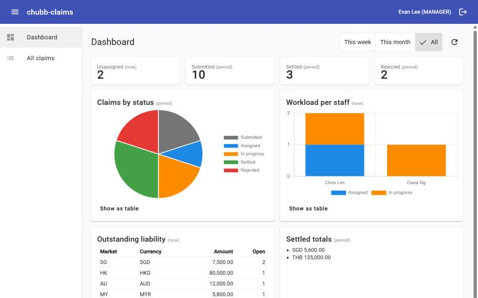

# End-to-end smoke tests (NFR-13)

Recorded on 2026-11-25 (Windows 11, Docker 20.10.17, Compose v2.7.0) with:

```powershell
docker compose up -d --build --wait; node tests/smoke.mjs; docker compose down
```

The raw output of the last run is in [`last-run.log`](last-run.log).

## 1. Scripted flow: `node tests/smoke.mjs`

Runs through nginx on http://localhost:4200. Result: **46/46 checks passed**. The script compares the dashboard before and after, so it passes on a fresh or a used database.

| Stage | Checks |
|---|---|
| nginx | Serves the Angular app; SPA fallback for a deep link (`/staff/claims/1`) |
| Auth | Bad password → 401 `INVALID_CREDENTIALS`; no token → 401 `UNAUTHORIZED`; login for claimant1, manager1, staff1, staff2; `/api/auth/me` |
| 1. Claimant submits | Missing fields → 400 `VALIDATION_FAILED`; submit → 201 `SUBMITTED`; currency defaults SG → SGD; staff cannot submit → 403 |
| 2. Manager assigns | Staff cannot start an unassigned claim → 403; staff list; claimant cannot assign → 403; assign to staff1 → `ASSIGNED` |
| 3. Staff works it | staff2 cannot see it → 403; settle before start → 409 `INVALID_STATUS_TRANSITION`; start → `IN_PROGRESS`; staff asks for info, claimant replies, thread has 2 messages |
| 4. Decision | Assess 3800.00; settle 5000 (above assessed) → 400; settle 3800 → `SETTLED`; reject a settled claim → 409 |
| 5. Claimant sees it | Status `SETTLED` and the decision note; history `SUBMITTED → ASSIGNED → IN_PROGRESS → SETTLED`; claimant2 cannot see it → 404 |
| 6. Rejection path | Second claim (HK → HKD) assigned to staff2; staff1 cannot start it → 403; staff2 starts; reject without a note → 400; reject with a note → `REJECTED`; claimant sees the note; message on a closed claim → 409 `MESSAGING_NOT_ALLOWED` |
| 7. Dashboard | Staff cannot read it → 403; `submittedCount` +2; settled +1; rejected +1; SGD settled total +3800 |

Every response was checked for the `ApiResponse` envelope.

## 2. Browser walkthrough (http://localhost:4200)

Done once by hand on the first run: a claim entered entirely in the UI, ending in a rejection.

| # | Role | Action | Result |
|:-:|---|---|---|
| 1 | claimant1 | Log in, My claims | The claim the script settled shows as Settled |
| 2 | claimant1 | New claim: MOTOR, HK, HKD 9,500 | Currency auto-filled HKD; CLM-2026-000010 created, detail page shows Submitted, timeline has 1 entry |
| 3 | manager1 | Open claim, Assign… → Dana Ng | Status Assigned, timeline "Evan Lee → Dana Ng" |
| 4 | staff2 | My work queue | CLM-2026-000010 listed as Assigned |
| 5 | staff2 | Start work, Reject… with a note | Status Rejected, decision card with the note, "No actions for a closed claim" |
| 6 | claimant1 | Open the claim | Sees Rejected and the decision note |
| 7 | manager1 | Dashboard (All) | Counts and totals match the API (screenshot below) |

Reloading deep links (`/claimant/claims/new`, `/manager/claims/10`, `/staff/claims/10`) kept the session and landed on the right page.



## 3. Infrastructure checks

| Check | Result |
|---|---|
| `client` waits for `server` healthcheck | Yes: server `healthy`, then client started |
| Correlation id through nginx | `X-Correlation-Id` sent by the script appears in the server log lines (`[e2e-…-2] … Login failed`) |
| No secrets in logs | 0 matches for the demo password or `Bearer ey…` in `docker compose logs server` |
| Data survives `docker compose down` / `up` | Yes: seeders logged "skipped, data present" and earlier claims kept their status |
| H2 console in Docker | Off (`docker` profile) |

## 4. Unit and integration suites (same day, after the smoke run)

| Suite | Command | Result |
|---|---|---|
| Server | `cd server; .\mvnw.cmd test` | 255 tests, 0 failures, BUILD SUCCESS |
| Client | `cd client; npx ng test --watch=false --browsers=ChromeHeadless --code-coverage` | 270 of 270 passed, 97.61% line coverage |
